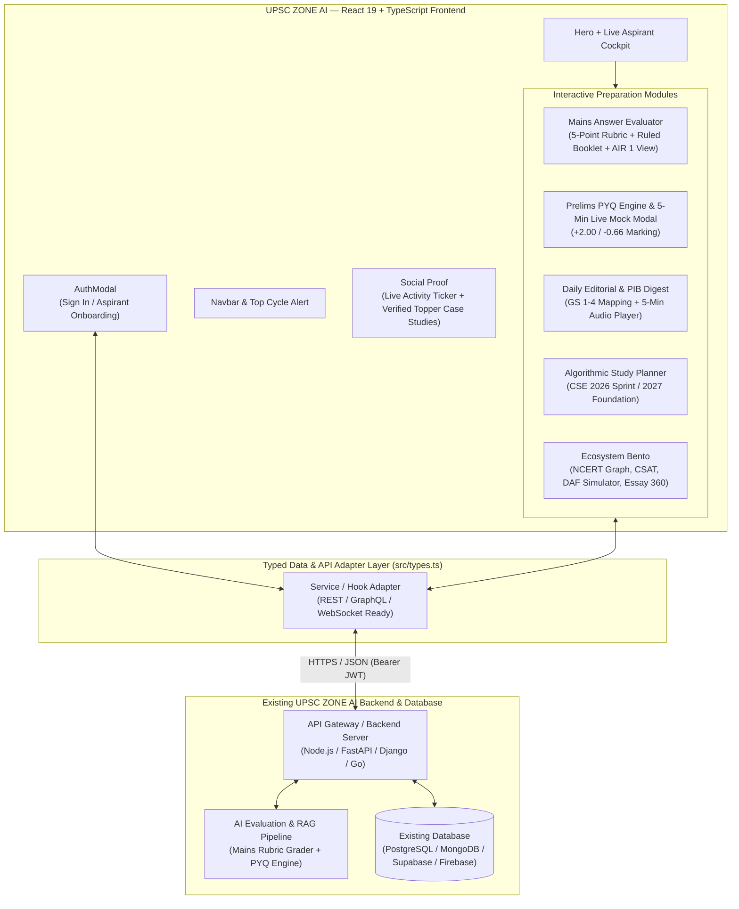
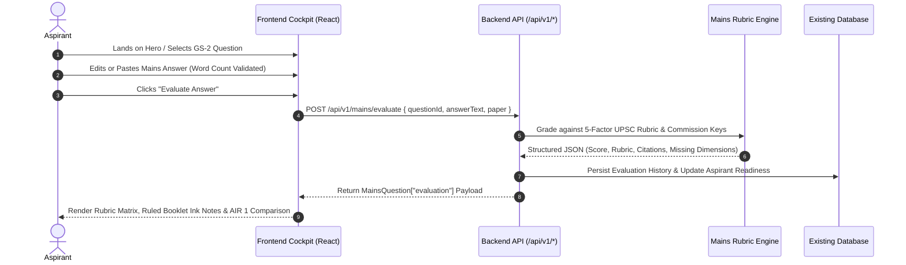

# UPSC ZONE AI — Production Frontend & Aspirant Cockpit

<div align="center">

**The Cognitive Command Center for Serious UPSC Civil Services (CSE 2026–2027) Aspirants**

[](https://react.dev/)
[](https://www.typescriptlang.org/)
[](https://tailwindcss.com/)
[](https://vitejs.dev/)

</div>

---

## 1. Overview & Design Philosophy

**UPSC ZONE AI** is a clean, high-conversion, aspirant-first web and mobile landing page engineered specifically for civil services preparation. Unlike generic SaaS templates, the UI is grounded in **Cognitive Ergonomics**:

- **Zero Eye-Fatigue Palette (60-30-10 Rule)**: Warm library parchment canvas (`#FAF9F6`), deep structural slate (`#1C1917`), and disciplined amber action accents (`#B45309`) designed for candidates studying 8–12 hours daily.
- **Editorial Typography (2+1 Font System)**:
  - **Display (`Cinzel`)**: Conveys constitutional authority and academic prestige.
  - **UI & Controls (`Plus Jakarta Sans`)**: Crisp legibility for rubrics, timers, and data tables.
  - **Long-Form Prose (`Source Serif 4`)**: Fatigue-free reading for Mains answers, PYQ statements, and editorials.
- **Strict 3-Zone Navigation & Responsive Architecture**: Tested across 1440px desktop viewports, tablets, and mobile devices with zero layout shift.

---

## 2. System & Frontend Architecture (Mermaid)



---

## 3. User Journey & Evaluation Flow



---

## 4. Key Implemented Features

| Module | Component | Highlights |
| :--- | :--- | :--- |
| **Navigation & Header** | `src/components/Navbar.tsx` | Sticky 3-zone top bar, section active tracking, mobile drawer, and live `CSE 2026` cycle countdown. |
| **Hero & Live Cockpit** | `src/components/Hero.tsx` | High-impact value proposition, interactive 3-tab preview cockpit (*Mains Evaluator*, *PYQ Eliminator*, *Daily Editorial*), and 4 quantitative proof counters. |
| **AI Mains Answer Evaluator** | `src/components/MainsEvaluatorDemo.tsx` | Editable answer box with live word counter, 5-factor rubric breakdown, **Official UPSC Ruled Answer Booklet** simulation (with Hindi/English margin warnings), and **AIR 1 Model Comparison**. |
| **Prelims PYQ & Mock Engine** | `src/components/PrelimsMockEngine.tsx` & `PrelimsMiniTestModal.tsx` | Multi-statement question solver with elimination logic, 10-year weightage matrix (`2014–2024`), plus a full **5-Minute Live Timed Mock Modal** with TCS iON palette and `-0.66` negative marking. |
| **Daily Current Affairs & Audio** | `src/components/CurrentAffairsFeed.tsx` & `AudioEditorialPlayer.tsx` | *The Hindu* & *PIB* briefs tagged to `GS-1`–`GS-4`, 3 Mains arguments, 2 Prelims facts, visual Concept Mind Map, and a **5-Minute Audio Brief Player** (`1x`, `1.25x`, `1.5x`). |
| **AI Study Planner** | `src/components/StudyPlannerWidget.tsx` | Interactive calculator by target year (`CSE 2026` vs `CSE 2027`), daily hours (`3h–14h`), profile category, and Optional subject. |
| **Holistic Ecosystem Bento** | `src/components/FeatureBento.tsx` | Connected NCERT Knowledge Graph, CSAT Passage Trap Detector, interactive **DAF Interview Question Generator**, and Essay 360 PESTEL Matrix. |
| **Social Proof & Comparison** | `src/components/Testimonials.tsx` & `ComparisonTable.tsx` | Verified topper case studies (`AIR 24`, `AIR 58`, `AIR 89`, `AIR 114`), live city ticker, and side-by-side coaching comparison table. |

---

## 5. Connecting Your Existing Backend & Database

This frontend is architected with **strict TypeScript contracts (`src/types.ts`)** and decoupled state so your engineering team can swap the mock data layer (`src/data/mockData.ts`) with your existing database (PostgreSQL, MongoDB, Supabase, Firebase, or custom REST/GraphQL microservices) in minutes.

### Step 1: Configure Environment Variables

Update `.env` (refer to `.env.example`):

```bash
# Base URL of your existing backend API
VITE_API_BASE_URL="https://api.upsczone.ai/v1"
```

### Step 2: Drop-In API Service Layer

Create `src/services/api.ts` (or point to your existing SDK) using the exact TypeScript interfaces already enforced across all UI components in `src/types.ts`:

```typescript
import {
  MainsQuestion,
  PrelimsQuestion,
  CurrentAffairArticle,
  TopperTestimonial,
} from '../types';

const API_BASE = import.meta.env.VITE_API_BASE_URL || '/api/v1';

async function request<T>(endpoint: string, options?: RequestInit): Promise<T> {
  const token = localStorage.getItem('upsczone_jwt');
  const response = await fetch(`${API_BASE}${endpoint}`, {
    ...options,
    headers: {
      'Content-Type': 'application/json',
      ...(token ? { Authorization: `Bearer ${token}` } : {}),
      ...options?.headers,
    },
  });
  if (!response.ok) throw new Error(`API Error: ${response.status}`);
  return response.json();
}

export const UpscZoneApi = {
  // 1. Mains AI Evaluation Endpoint
  evaluateMainsAnswer: (payload: {
    questionId: string;
    questionText: string;
    answerText: string;
    paper: 'GS-1' | 'GS-2' | 'GS-3' | 'GS-4' | 'Essay';
  }) =>
    request<MainsQuestion['evaluation']>('/mains/evaluate', {
      method: 'POST',
      body: JSON.stringify(payload),
    }),

  // 2. Prelims PYQ & Mock Questions from your Database
  getPrelimsQuestions: (subject?: string, year?: number) =>
    request<PrelimsQuestion[]>(
      `/prelims/questions?subject=${encodeURIComponent(subject || 'All')}&year=${year || ''}`
    ),

  // 3. Daily Current Affairs & Editorial Synthesis
  getDailyEditorials: (gsPaper?: string, date?: string) =>
    request<CurrentAffairArticle[]>(
      `/current-affairs?paper=${encodeURIComponent(gsPaper || 'All')}&date=${date || ''}`
    ),

  // 4. Aspirant Authentication & Onboarding
  authenticate: (mode: 'signin' | 'signup', body: Record<string, string>) =>
    request<{ token: string; user: { name: string; targetYear: string; optionalSubject: string } }>(
      `/auth/${mode}`,
      { method: 'POST', body: JSON.stringify(body) }
    ),

  // 5. Topper Testimonials / Ranker Proof
  getTopperTestimonials: () => request<TopperTestimonial[]>('/testimonials'),
};
```

### Step 3: Expected Backend JSON Contracts (`src/types.ts`)

Your backend or database serializers only need to return JSON matching `src/types.ts`:

| UI Component | TypeScript Interface (`src/types.ts`) | Recommended Backend Endpoint |
| :--- | :--- | :--- |
| `MainsEvaluatorDemo.tsx` | `MainsQuestion` | `GET /api/v1/mains/questions` & `POST /api/v1/mains/evaluate` |
| `PrelimsMockEngine.tsx` | `PrelimsQuestion` | `GET /api/v1/prelims/questions` |
| `PrelimsMiniTestModal.tsx` | `PrelimsQuestion[]` | `POST /api/v1/prelims/mock-submit` |
| `CurrentAffairsFeed.tsx` | `CurrentAffairArticle` | `GET /api/v1/current-affairs` |
| `AuthModal.tsx` | `{ name, email, targetYear, optionalSubject }` | `POST /api/v1/auth/signin` & `POST /api/v1/auth/signup` |

---

## 6. Project Structure

```text
├── index.html                           # SEO meta tags, OpenGraph cards & Google Fonts
├── metadata.json                        # Application metadata
├── package.json                         # Dependencies & build scripts
├── vite.config.ts                       # Vite + Tailwind v4 configuration
└── src/
    ├── main.tsx                         # React 19 root mount
    ├── index.css                        # Tailwind CSS v4 + custom font variables
    ├── types.ts                         # Strict TypeScript interfaces for API & DB models
    ├── App.tsx                          # Main layout orchestrator & modal controllers
    ├── data/
    │   └── mockData.ts                  # Fallback/seed UPSC dataset (replaceable via API)
    └── components/
        ├── Navbar.tsx                   # 3-zone sticky navigation bar + mobile drawer
        ├── LiveAspirantTicker.tsx       # Real-time community activity bar
        ├── Hero.tsx                     # Hero section + interactive Aspirant Cockpit
        ├── MainsEvaluatorDemo.tsx       # AI Mains evaluator (Rubric + Ruled Sheet + AIR 1)
        ├── PrelimsMockEngine.tsx        # PYQ elimination trainer + 10-yr weightage table
        ├── PrelimsMiniTestModal.tsx     # Full 5-min timed mock test simulator modal
        ├── CurrentAffairsFeed.tsx       # The Hindu & PIB syllabus-mapped daily digest
        ├── AudioEditorialPlayer.tsx     # 5-minute audio brief player with waveform
        ├── StudyPlannerWidget.tsx       # Algorithmic CSE 2026/2027 study roadmap calculator
        ├── FeatureBento.tsx             # NCERT graph, CSAT, DAF simulator & Essay 360
        ├── Testimonials.tsx             # Verified topper ranker case studies
        ├── ComparisonTable.tsx          # UPSC ZONE AI vs traditional coaching matrix
        ├── CTASection.tsx               # Validated lead capture & free-tier onboarding
        ├── AuthModal.tsx                # Sign-in and registration modal
        └── Footer.tsx                   # 4-column syllabus repository & legal disclaimer
```

---

## 7. Local Development & Production Build

```bash
# 1. Install dependencies
npm install

# 2. Start development server on port 3000
npm run dev

# 3. Type-check with TypeScript
npm run lint

# 4. Build optimized production bundle (outputs to /dist)
npm run build
```
